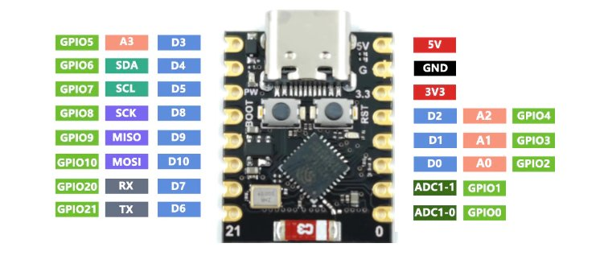

# Hardware und GPIO-Belegung

_Stand: November 2026 · Board: ESP32-C3 Super Mini_

Maßgeblich im Code ist [`include/pins.h`](../include/pins.h). Pins nur dort ändern, nie direkt in den Modulen.
Jeder Pin lässt sich für eine andere Hardware-Variante per `build_flags = -DPIN_…=x` überschreiben.



---

## Verdrahtung (Draufsicht)

```
                              ┌─── USB-C ───┐   ← Aufspielen (USB-JTAG, GPIO18/19)
                              │             │
    RDA5807M SDA ─── G5 ──────┤             ├──── 5V  ──────────── [5V Netzteil]
    RDA5807M SCL ─── G6 ──────┤             ├──── GND ──────────── [GND Sammelschiene]
    RDA5807M VCC ─── G7 ──────┤  ESP32-C3   ├──── 3V3 ──────────── [3V3]
   (Onboard LED) ─── G8 ──────┤  Super Mini ├──── G4  ── CLK ─┐
   (Boot-Taster) ─── G9 ──────┤             ├──── G3  ── SW  ─┤── KY-040 Encoder
    WS2812B Data ─── G10 ─────┤  ┌───────┐  ├──── G2  ── DT  ─┘
      (RX0 frei) ─── G20 ─────┤  │ Chip  │  ├──── G1  ──────────── XTAL_32K_N ─┐
  Serial-Log TX0 ─── G21 ─────┤  └───────┘  ├──── G0  ──────────── XTAL_32K_P ─┴─ 32k Quarz (opt.)
                              │             │
                              └─────────────┘

Stromversorgung der Peripherie:
  RDA5807M VCC/GND    ── über G7 geschaltet (LOW = stromlos)
  WS2812B  VCC        ── 5V direkt
  KY-040   VCC        ── 3V3
```

---

## Belegung

| GPIO | Konstante (`pins.h`) | Funktion | Modul | Richtung | Anmerkungen |
|-----:|---|---|---|:---:|---|
| 0 | — | XTAL_32K_P | RTC-Quarz (optional) | — | fest im Chip; Anlauf-Pulse beim Aktivieren |
| 1 | — | XTAL_32K_N | RTC-Quarz (optional) | — | fest im Chip; nichts anderes anschließen |
| 2 | `PIN_ENCODER_DT` | Encoder DT | KY-040 | IN | interner Pullup (Modul hat eigene Pullups) |
| 3 | `PIN_ENCODER_SW` | Encoder-Taster | KY-040 | IN | gedrückt = LOW; Pullup + Pad-Hold im Deep Sleep → **Wakeup** |
| 4 | `PIN_ENCODER_CLK` | Encoder CLK | KY-040 | IN | Pullup + Pad-Hold im Deep Sleep → **Wakeup** bei Drehung |
| 5 | `PIN_RDS_SDA` | I²C SDA | RDA5807M | BIDIR | 4,7 kΩ Pullup auf 3V3 empfohlen |
| 6 | `PIN_RDS_SCL` | I²C SCL | RDA5807M | OUT | 4,7 kΩ Pullup auf 3V3 empfohlen |
| 7 | `PIN_RDS_POWER` | Modul-Strom | RDA5807M | OUT | HIGH = an, LOW = stromlos |
| 8 | `PIN_STATUS_LED` | Status-LED | Onboard (blau) | OUT | invertiert (LOW = an) |
| 9 | `PIN_BOOT_BUTTON` | Boot-Taster | Onboard | IN | gedrückt = LOW; 1 s halten = Werksreset |
| 10 | `PIN_LED_STRIP` | LED-Daten | WS2812B GRBW (Anzahl einstellbar, Standard 4) | OUT | 300–500 Ω Serienwiderstand empfohlen |
| 18–19 | — | USB D−/D+ | USB-JTAG | BIDIR | Aufspielen; im Deep Sleep abgeschaltet |
| 20 | — | RX0 | UART0 | IN | frei |
| 21 | — | TX0 | UART0 | OUT | serielles Log (115200 Baud, z. B. FTDI-Adapter) |
| 12–17 | — | Flash-SPI | internes Flash | — | reserviert, nie als GPIO verwenden |

**Deep-Sleep-Wakeup** funktioniert nur an RTC-fähigen GPIOs (0–5). `PIN_ENCODER_SW` und `PIN_ENCODER_CLK`
müssen deshalb dort liegen. CLK weckt nur, wenn der Pin vor dem Schlaf HIGH ist (Encoder in Rastung).

---

## Empfohlene Schutzbeschaltung

| Bauteil | Maßnahme |
|---|---|
| WS2812B Data | 300–500 Ω Serienwiderstand direkt an GPIO10 |
| RDA5807M I²C | 4,7 kΩ Pullups SDA und SCL → 3V3 |
| RDA5807M Strom | GPIO7 → NPN-Transistor oder P-Kanal-MOSFET |
| 32-kHz-Quarz | so nah wie möglich an GPIO0/GPIO1 |

---

## Encoder (KY-040)

- 4 Signalwechsel pro Rastung (voller Quadratur-Zyklus), in der Rastung sind DT und CLK beide HIGH.
- Die Firmware zählt die Rohflanken und wertet erst in der Rastung aus (`handleRotation()` in
  `src/button.cpp`). Prellen und verlorene Flanken verschieben die Zählung dadurch nicht dauerhaft.
- Die Beschleunigung der Bibliothek AiEsp32RotaryEncoder ist abgeschaltet.

---

## Optionaler 32,768-kHz-Uhrenquarz (XTAL_32K)

| Taktquelle | Typische Abweichung |
|---|---|
| Interner RC-Oszillator | ca. 1–2 % (bei 5 h Deep Sleep einige Minuten) |
| Externer 32k-Quarz | ca. 20–100 ppm (wenige Sekunden pro Tag) |

`src/rtc_crystal.cpp` prüft bei **jedem Einschalten** (nicht nach Deep Sleep) per `rtc_clk_cal()`, ob ein
Quarz schwingt (32.000–33.000 Hz) — auch wenn er deaktiviert ist. Ohne erkannten Quarz ist der Schalter
in der Weboberfläche gesperrt; ist er aktiviert, aber nicht vorhanden, bleibt der RC-Oszillator aktiv. Ein- und ausschalten über die Weboberfläche
(Einstellungen → Energie & Uhr); die Umschaltung erfordert einen Neustart.
Der Deep-Sleep-Vorlauf rechnet mit 1,5 % (RC) bzw. 100 ppm (Quarz) Abweichung.
